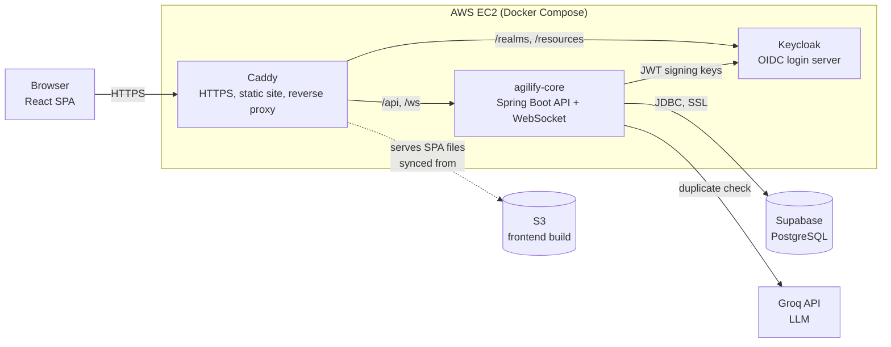
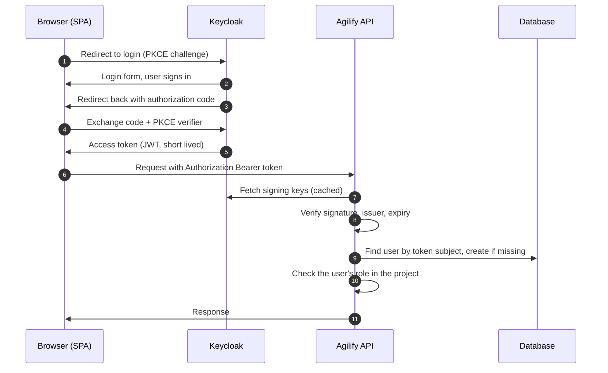
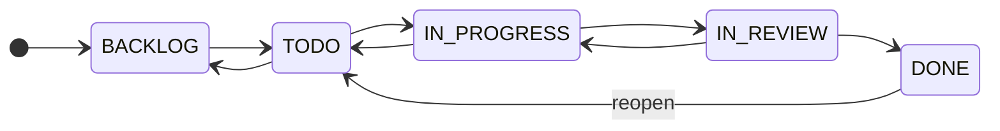
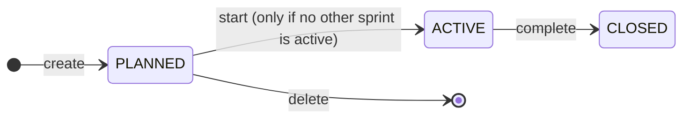
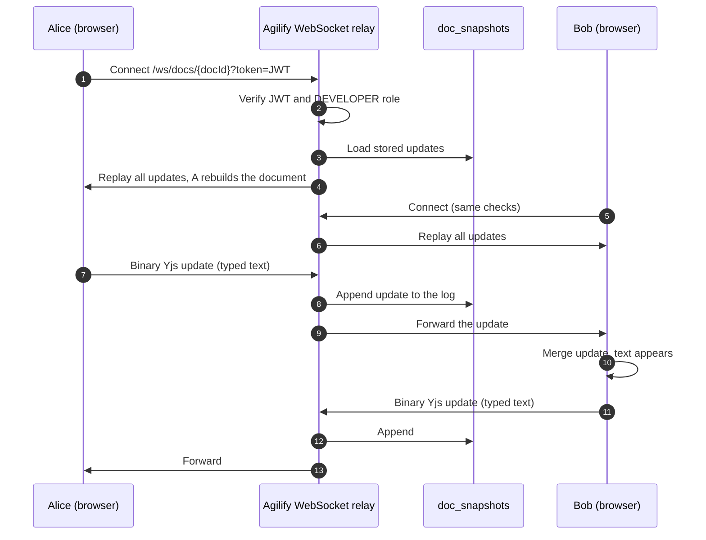
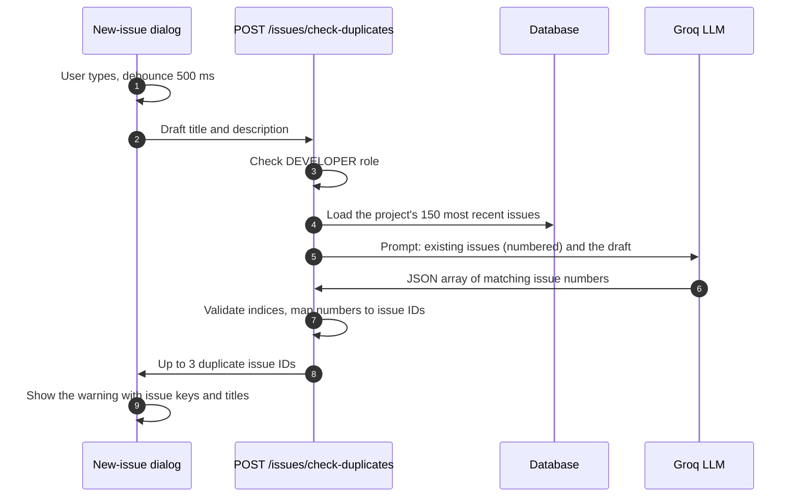
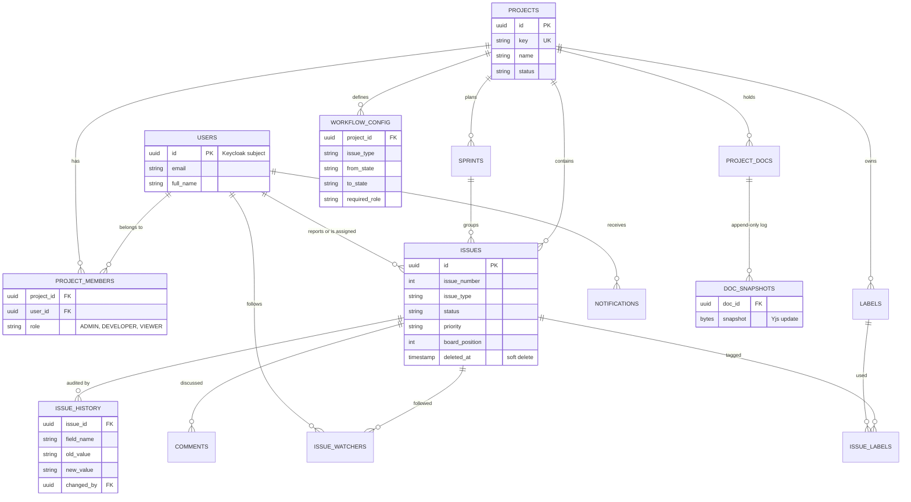
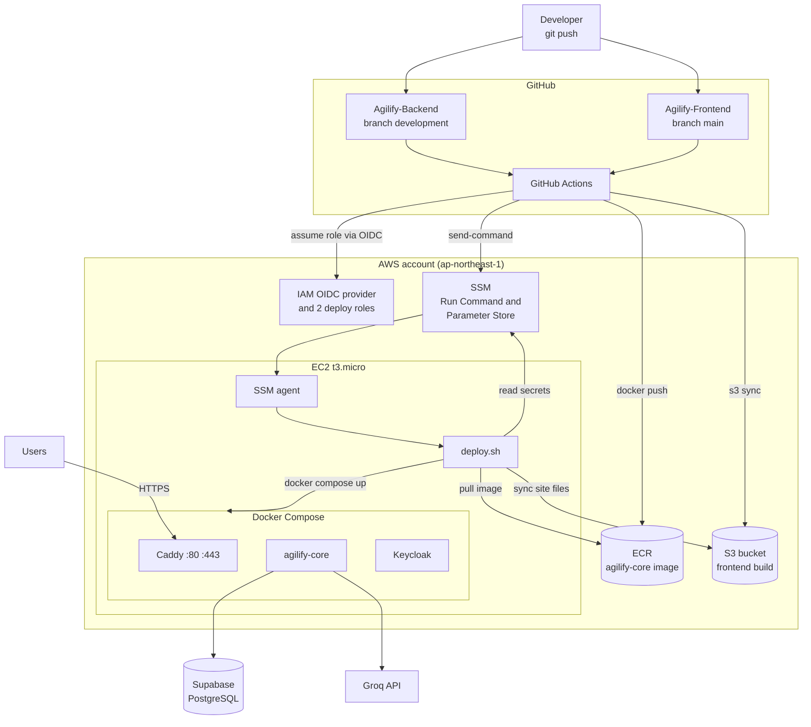
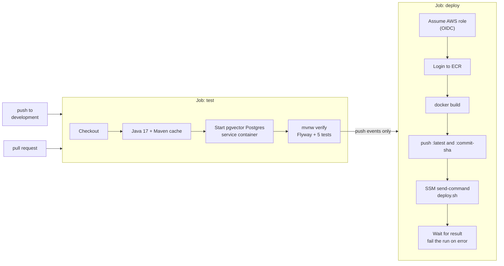

# Agilify

**Agilify is a Jira-style agile project management system with real-time collaborative documents and AI-assisted duplicate detection.** Teams plan work in projects, break it into issues, run it through sprints on a Kanban board, discuss and track every change, and write shared documents together live in the browser.

This repository is the **backend** (Spring Boot REST + WebSocket API). The React frontend lives in [Agilify-Frontend](https://github.com/im-rk/Agilify-Frontend).

It was built as a DBMS and cloud computing semester project, and it is deployed end to end on the AWS free plan with a managed Postgres on Supabase and a fully automated CI/CD pipeline (see [DevOps](#10-devops-aws-cicd-end-to-end)).

---

## Contents

1. [What you get](#1-what-you-get)
2. [Architecture](#2-architecture)
3. [Authentication and users (Keycloak)](#3-authentication-and-users-keycloak)
4. [Roles and permissions (RBAC)](#4-roles-and-permissions-rbac)
5. [Features in detail](#5-features-in-detail)
6. [AI: semantic duplicate detection](#6-ai-semantic-duplicate-detection)
7. [Data model](#7-data-model)
8. [API reference](#8-api-reference)
9. [Run it locally](#9-run-it-locally)
10. [DevOps: AWS, CI/CD end to end](#10-devops-aws-cicd-end-to-end)
11. [Testing](#11-testing)
12. [Project layout](#12-project-layout)
13. [Known limitations](#13-known-limitations)

---

## 1. What you get

| Area | Summary |
|---|---|
| **Projects and members** | Create projects with a short key (like `FOOD`), invite existing users, assign per-project roles |
| **Issues** | Bug, Story, Task and Epic issues with priority, story points, due date, assignee, labels; human keys like `FOOD-42` |
| **Workflow guard** | Status changes are validated against a per-project state machine; illegal moves are rejected with a clear error |
| **Issue history** | Append-only audit trail of every field change: who, what, old value, new value, when |
| **Sprints and board** | Plan sprints, drag cards across a Kanban board, complete a sprint and roll unfinished work over |
| **Backlog** | Everything not in a sprint, with one-click move to a sprint |
| **Comments** | Threaded discussion on issues; edit and delete limited to the author or an admin |
| **Labels** | Per-project colored labels attached to issues |
| **Watchers and notifications** | Follow an issue and get notified when it changes; in-app notification bell |
| **Live collaborative docs** | Project documents edited by several people at once, merged conflict-free with a CRDT (Yjs) over WebSockets |
| **AI duplicate detection** | While typing a new issue, an LLM (Groq) warns when it looks like an existing one |
| **Authentication** | Single sign-on through Keycloak (OIDC), no passwords stored by the app |
| **Security** | Per-project role-based access control enforced on every endpoint |
| **API docs** | OpenAPI / Swagger UI generated from the code |
| **Cloud deployment** | AWS EC2 + Supabase + S3 + ECR + SSM, deployed by GitHub Actions with no stored AWS keys |

---

## 2. Architecture



**One public origin.** The browser only ever talks to a single HTTPS address. Caddy serves the React build and routes `/api` and `/ws` to the backend and `/realms` and `/resources` to Keycloak. That avoids mixed-content and cross-origin problems and means there is exactly one door into the system.

**Stateless API.** The backend keeps no session state. Identity comes from a signed JWT on every request, so the API can be restarted or replaced at any time. The collaborative-doc relay is also stateless: it forwards binary frames and persists them, it does not interpret them.

**Tech stack**

| Layer | Technology |
|---|---|
| Language and framework | Java 17, Spring Boot 3.3.4 |
| API | Spring Web, Bean Validation, springdoc OpenAPI |
| Security | Spring Security OAuth2 resource server (Keycloak JWT), method-level `@PreAuthorize` |
| Persistence | Spring Data JPA / Hibernate (`ddl-auto=validate`), Flyway migrations, PostgreSQL |
| Mapping | MapStruct, Lombok |
| Real time | Spring WebSocket (binary frames), Yjs CRDT on the client |
| Identity | Keycloak 24 (OIDC, PKCE) |
| AI | Groq OpenAI-compatible chat API (`openai/gpt-oss-20b`) |
| Frontend | React 19, Vite, Tailwind CSS 4, shadcn/ui, TanStack Query, dnd-kit, Yjs |
| Packaging | Docker, Docker Compose |
| Cloud | AWS EC2, ECR, S3, SSM, IAM (OIDC), Supabase, Let's Encrypt via Caddy |
| CI/CD | GitHub Actions |

---

## 3. Authentication and users (Keycloak)

Agilify has **no login page and no password table**. Authentication is delegated entirely to [Keycloak](https://www.keycloak.org/), an open-source identity provider, using the OpenID Connect **Authorization Code flow with PKCE**.



**How it works**

- The frontend (`keycloak-js`) sends the browser to Keycloak to log in. On return it holds a short-lived access token (JWT) and attaches it to every API call and to the WebSocket handshake.
- The API is an **OAuth2 resource server**: it validates the token's signature (using Keycloak's published keys), its issuer, and its expiry. It never sees a password.
- **Automatic user provisioning.** On a user's first authenticated request, `UserSyncFilter` reads the token claims (`sub`, `email`, `name`) and creates the user row. The token's `sub` becomes the user's primary key, so identity is stable. There is no signup endpoint to build or secure.
- **Authorization lives in the app, not in Keycloak.** Keycloak answers "who are you?". The application answers "what may you do here?" using per-project roles stored in its own database (next section).
- `keycloak/agilify-realm.json` is a ready-made realm (client `agilify-app`, demo users). Keycloak imports it automatically the first time it starts with an empty data volume.

> A Keycloak user must have an **email** address. The API requires it when creating the user row.

---

## 4. Roles and permissions (RBAC)

Roles are **per project**, not global. The same person can be an admin in one project and only a viewer in another. The hierarchy is cumulative: `ADMIN` includes everything `DEVELOPER` can do, and `DEVELOPER` includes everything `VIEWER` can do.

| Capability | VIEWER | DEVELOPER | ADMIN |
|---|:---:|:---:|:---:|
| View project, issues, board, backlog, sprints, history, labels | yes | yes | yes |
| Comment on issues, watch and unwatch | yes | yes | yes |
| Edit or delete **own** comments | yes | yes | yes |
| Create and edit issues, change status, assign, move on the board | | yes | yes |
| Create, edit, start, complete, delete sprints | | yes | yes |
| Create labels, attach and detach labels | | yes | yes |
| Run the AI duplicate check | | yes | yes |
| See the list of a project's documents and their titles | yes | yes | yes |
| Create, rename, delete, **open and edit live**, compact a document | | yes | yes |
| Edit or delete **anyone's** comment | | | yes |
| Add or remove project members, update project settings | | | yes |
| Delete labels | | | yes |

Rules worth knowing:

- Enforcement is on the **server**, in `@PreAuthorize` expressions backed by `ProjectSecurityService` and `CommentSecurityService`. The UI hiding a button is a convenience, never the protection.
- A user who is **not a member** of a project cannot read anything in it.
- Viewers can see that documents exist (titles in the list) but cannot open them: the WebSocket handshake rejects anyone below Developer, and the "compact" endpoint requires Developer too, so a read-only user can neither read content nor wipe a document.

---

## 5. Features in detail

### 5.1 Projects and members

- A project has a name, a unique **key** (2 to 10 uppercase letters, for example `FOOD`), a description and a status (`ACTIVE` or `ARCHIVED`).
- The creator becomes the project's **ADMIN** automatically.
- Admins add members by looking up an existing user by email (`GET /users/search`) and assigning a role. Because users are created on first login, a person must have signed in once before they can be added.
- Members and their roles are listed for the whole team to see.
- The **last admin cannot be removed**, so a project can never end up with nobody able to manage it.

### 5.2 Issues

- **Types:** `BUG`, `STORY`, `TASK`, `EPIC`. **Priorities:** `P1` to `P4`.
- Each issue has a title, description, story points (non-negative), due date, reporter, optional assignee, optional sprint, and a status.
- **Keys are human readable and sequential per project:** `FOOD-1`, `FOOD-2`, and so on. To make numbering safe under concurrency, the project row is locked while the next number is computed, so two people creating issues at the same instant never collide or skip.
- New issues start in `BACKLOG`. The reporter becomes a watcher automatically, and so does the assignee.
- The assignee must be a **member of the project**.
- **Soft delete:** deleting an issue sets a `deleted_at` timestamp. The row stays for history and integrity, and is excluded from every query.
- Issue lists are paginated and can be filtered by status and priority.

### 5.3 Workflow guard (status state machine)

Moving an issue to a new status is not a free-for-all. Each project has a **workflow** stored in the `workflow_config` table: the list of allowed `from -> to` transitions, per issue type. Every project receives this default when it is first needed:



- A request such as `BACKLOG -> DONE` is rejected with **HTTP 422** and a message naming the issue type and the two states.
- A transition row can also carry a **required role**, so a project can restrict, for instance, who may close an issue. The guard enforces it.
- Moving to the status the issue is already in is a harmless no-op.
- Reaching `DONE` stamps `completed_at`; reopening clears it.
- A rejected change writes **nothing**: no status change, no history entry, no notification.

### 5.4 Issue history (audit trail)

Every change to these fields is recorded in the append-only `issue_history` table: `status`, `assignee_id`, `title`, `description`, `priority`, `issue_type`, `story_points`, `due_date` and `sprint_id`. Each row stores **who** changed it, **which field**, the **old and new value**, **when**, and an optional reason (for example "Sprint completed"). Unchanged fields produce no entry, so the trail is free of noise. History is readable by any project member.

### 5.5 Sprints, backlog and the Kanban board



- A sprint has a name, optional goal, start and end dates, and a status.
- **Only one sprint can be active per project.** Starting a second one is refused.
- Only a **PLANNED** sprint can be edited or deleted. A sprint is closed only through the dedicated **complete** action, never by a plain status change.
- **Completing a sprint** closes it and handles unfinished work: every issue not in `DONE` is moved to a sprint you choose (any open one) or back to the backlog. Each move is recorded in the issue history with the reason "Sprint completed".
- **Backlog:** all issues that are not in a sprint, with a quick action to move any issue into a sprint.
- **Board:** the active sprint's issues grouped into status columns. Dragging a card changes its status (through the workflow guard) and stores its **position** within the column so the order survives a reload. If no sprint is active the board reports "no active sprint" and the UI shows an empty state.

### 5.6 Comments

- Comments are **threaded**: a root comment, or a reply to another comment.
- Any project member, including viewers, can read and write comments.
- **Edit and delete are limited to the comment's author or a project admin.** Deleting is a soft delete.
- Comments are returned in chronological order.

### 5.7 Labels

- Labels belong to a project and have a name and a color.
- Developers create labels and attach or detach them on issues. A label can be created straight from the issue's label picker.
- Only admins can delete a label. Deleting a label removes it from the issues that used it.

### 5.8 Watchers and notifications

- A user can **watch** or unwatch any issue they can see. Reporters and assignees watch automatically.
- When a watched issue changes, **every watcher except the person who made the change** receives a notification. Three kinds are produced: `ISSUE_STATUS_CHANGED`, `ISSUE_ASSIGNED` (assignee change) and `ISSUE_UPDATED` (any other tracked field).
- A notification carries the issue key, a short body such as "status changed from TODO to IN_PROGRESS", and the project key so the UI can link to it.
- Users list their notifications, mark one as read, or mark all as read. The web app polls every 30 seconds to update the bell.

### 5.9 Live collaborative documents (CRDT)

Each project can hold documents that several people edit **simultaneously**, with no locking and no "someone else is editing" conflicts.



- **CRDT, not locking.** The client uses [Yjs](https://yjs.dev/), a Conflict-free Replicated Data Type. Edits made at the same time, even offline, merge deterministically on every client without a central referee.
- **The server is a dumb, fast relay.** It never parses the document. It appends each binary update to an append-only log (`doc_snapshots`), forwards it to every other connected session, and replays the log to anyone who connects.
- **Auth on the socket.** Browsers cannot set headers on a WebSocket, so the JWT is passed as `?token=`. A handshake interceptor validates it and requires at least the Developer role in the doc's project before the connection is accepted.
- **Compaction.** A log that grows forever is wasteful, so a client can post its fully merged state to `/compact`, which replaces the whole log with a single snapshot.
- Documents can be created, renamed and deleted by Developers; the editor shows a **Live / Disconnected** indicator and disables typing when not connected.

### 5.10 Consistent errors and API docs

- Every error uses one JSON shape (`status`, `error`, `message`, `path`, `timestamp`, `validationErrors`) produced by a global exception handler. Typical codes: 400 validation, 403 forbidden, 404 not found, 409 conflict, 422 workflow violation.
- Swagger UI is served at `/swagger-ui.html` and the OpenAPI document at `/v3/api-docs` when running locally.

---

## 6. AI: semantic duplicate detection

**The problem.** In a busy backlog, different people report the same bug in different words: "Login page is broken" and "Auth throws 500 error". A plain `LIKE` search can never connect those.

**The feature.** While you type a new issue, Agilify shows an amber warning: *"Looks similar to an existing issue: FOOD-12: Login page is broken."* It is advisory only and never blocks creation.



**How it works**

1. The API loads the project's most recent issues (title plus a trimmed description) and numbers them.
2. It sends them with the draft to a Groq-hosted LLM with a strict instruction: return only a JSON array of the numbers that describe the **same underlying problem**, most similar first, at most three, and treat the text as data, never as instructions.
3. The reply is parsed defensively: only numbers within the valid range are accepted and mapped back to real issue IDs. A malicious issue title cannot make the model return anything but indices, so the worst case is a wrong suggestion.
4. The UI debounces typing (500 ms) so it calls the endpoint when you pause, not on every keystroke.

**Design decisions**

- **Why an LLM and not vector search?** The first implementation used pgvector with local embeddings. Groq offers chat models but no embeddings model, and a local embedding server does not fit a 1 GB free-tier server. Having the LLM compare directly needs no extra infrastructure and is accurate for the size of backlog a team actually reads. The `vector` extension migration (V6) is still present so existing databases validate.
- **Graceful degradation.** If the API key is missing, or Groq is unreachable or slow, the endpoint simply returns an empty list and the rest of the app is unaffected.
- **Scale limit, stated honestly.** It considers the 150 most recent issues per check. For backlogs in the thousands, add a cheap pre-filter (full-text search or embeddings) before the LLM.
- **Privacy note.** Issue titles and descriptions of the project are sent to Groq for each check. Use a provider you trust for the data you store.
- The API key is read from the `GROQ_API_KEY` environment variable and is never stored in the repository; in production it is held in AWS SSM Parameter Store.

---

## 7. Data model

Schema is managed by **Flyway** (six versioned migrations in `src/main/resources/db/migration`). Hibernate runs in `validate` mode, so the application refuses to start if the code and the schema disagree.



Design points: UUID primary keys everywhere; the user's primary key **is** the Keycloak subject; soft deletes via `deleted_at`; history and document updates are append-only; issue numbers are unique per project.

---

## 8. API reference

Base path `/api/v1`. All endpoints require a valid Bearer JWT. `{key}` is the project key. The **Role** column is the minimum role in that project.

| Module | Method and path | Role | Purpose |
|---|---|---|---|
| Projects | `POST /projects` | any user | Create a project (creator becomes admin) |
| | `GET /projects` | any user | Projects you belong to |
| | `GET /projects/{key}` | member | Project details |
| | `PUT /projects/{key}` | admin | Update project |
| | `GET /projects/{key}/members` | member | List members and roles |
| | `POST /projects/{key}/members` | admin | Add a member |
| | `DELETE /projects/{key}/members/{memberId}` | admin | Remove a member |
| Users | `GET /users/search?email=` | any user | Find a user to add |
| Issues | `POST /projects/{key}/issues` | developer | Create an issue |
| | `GET /projects/{key}/issues` | member | Paged list, filter by status and priority |
| | `GET /projects/{key}/issues/{id}` | member | Issue details |
| | `PUT /projects/{key}/issues/{id}` | developer | Edit fields |
| | `PATCH /projects/{key}/issues/{id}/status` | developer | Change status (workflow guard) |
| | `PATCH /projects/{key}/issues/{id}/assignee` | developer | Assign or unassign |
| | `DELETE /projects/{key}/issues/{id}` | developer | Soft delete |
| | `GET /projects/{key}/issues/{id}/history` | member | Audit trail |
| | `POST /projects/{key}/issues/check-duplicates` | developer | AI duplicate check |
| Sprints | `POST /projects/{key}/sprints` | developer | Create sprint |
| | `GET /projects/{key}/sprints`, `GET .../{sprintId}` | member | List, details |
| | `PUT /projects/{key}/sprints/{sprintId}` | developer | Edit (planned only) |
| | `PATCH .../{sprintId}/status` | developer | Start (planned to active) |
| | `POST .../{sprintId}/complete` | developer | Close and roll over |
| | `DELETE .../{sprintId}` | developer | Delete (planned only) |
| Board | `GET /projects/{key}/board` | member | Active sprint board |
| | `GET /projects/{key}/sprints/{sprintId}/board` | member | A given sprint's board |
| | `GET /projects/{key}/backlog` | member | Issues not in a sprint |
| | `PATCH /projects/{key}/issues/{id}/sprint` | developer | Move to or from a sprint |
| | `PATCH /projects/{key}/issues/{id}/position` | developer | Reorder on the board |
| Comments | `POST`, `GET /issues/{issueId}/comments` | member | Add, list |
| | `PUT`, `DELETE /issues/{issueId}/comments/{id}` | author or admin | Edit, soft delete |
| Labels | `POST`, `GET /projects/{key}/labels` | developer / member | Create, list |
| | `DELETE /projects/{key}/labels/{labelId}` | admin | Delete |
| | `POST`, `DELETE /projects/{key}/issues/{id}/labels/{labelId}` | developer | Attach, detach |
| | `GET /projects/{key}/issues/{id}/labels` | member | Labels on an issue |
| Watchers | `POST`, `DELETE`, `GET /projects/{key}/issues/{id}/watchers` | member | Watch, unwatch, list |
| Notifications | `GET /notifications` | any user | Your notifications |
| | `POST /notifications/{id}/read`, `POST /notifications/read-all` | any user | Mark read |
| Docs | `POST /projects/{key}/docs` | developer | Create |
| | `GET /projects/{key}/docs`, `GET .../{docId}` | member | List and read document details (titles, metadata) |
| | `DELETE .../{docId}`, `PATCH .../{docId}/title` | developer | Delete, rename |
| | `POST /projects/{key}/docs/{docId}/compact` | developer | Replace the update log with a merged snapshot |
| WebSocket | `GET /ws/docs/{docId}?token=JWT` | developer | Live collaboration channel |

---

## 9. Run it locally

**Prerequisites:** Docker, Java 17, and (for the UI) Node 22.

```bash
# 1. Infrastructure: Postgres (pgvector image) and Keycloak
docker compose up -d db keycloak

# 2. Backend (http://localhost:8082)
GROQ_API_KEY=your-key-optional ./mvnw spring-boot:run
```

- **Keycloak** runs on http://localhost:8180 (admin console login `admin` / `admin`). On the first start with an empty volume it imports `keycloak/agilify-realm.json`: realm `agilify`, client `agilify-app`, and demo users `alice`, `bob`, `carol` (password `Passw0rd!`). If the realm already exists in your volume the import is skipped.
- **Postgres** is on `localhost:5434` (database `bugtracker`, user `bugtracker_user`). The `db` service uses the `pgvector/pgvector` image because migration V6 runs `CREATE EXTENSION vector`.
- **AI** works only when `GROQ_API_KEY` is set. Without it everything else still works and the duplicate check returns nothing.
- **Swagger UI:** http://localhost:8082/swagger-ui.html
- **Frontend:** clone [Agilify-Frontend](https://github.com/im-rk/Agilify-Frontend), run `npm install` and `npm run dev`. It must run on **port 5173**, which is the redirect URI the Keycloak client allows.

**Configuration** (environment variables override `application.properties`):

| Variable | Default | Purpose |
|---|---|---|
| `SPRING_DATASOURCE_URL` / `_USERNAME` / `_PASSWORD` | local Postgres | Database connection |
| `KEYCLOAK_ISSUER_URI` | `http://localhost:8180/realms/agilify` | Expected token issuer |
| `SPRING_SECURITY_OAUTH2_RESOURCESERVER_JWT_JWK_SET_URI` | derived from issuer | Where to fetch signing keys (set when the issuer's public URL is not reachable from the API) |
| `CORS_ALLOWED_ORIGINS` | `http://localhost:5173,http://localhost:3000` | Allowed browser origins |
| `WEBSOCKET_ALLOWED_ORIGINS` | same | Allowed WebSocket origins |
| `GROQ_API_KEY` | empty | Enables the AI duplicate check |
| `GROQ_MODEL` (`groq.model`) | `openai/gpt-oss-20b` | Model used |

---

## 10. DevOps: AWS, CI/CD end to end

Everything below is automated: a push to GitHub tests, builds, ships and restarts the system with no manual steps and **no long-lived AWS credentials stored anywhere**.

### 10.1 Environments and cost

| Item | Choice |
|---|---|
| Region | AWS `ap-northeast-1` (Tokyo), same region as the database |
| Compute | One `t3.micro` EC2 instance (Ubuntu 22.04, 20 GB gp3, 2 GB swap) |
| Database | Supabase managed PostgreSQL, **Session pooler** on port 5432 |
| Plan | AWS Free plan (credits-based; AWS stops the account rather than billing past the credits) |
| Cost | About $15 per month running 24/7, about $5.5 per month when the instance is stopped |
| Deliberately avoided | EKS, ALB/NLB, NAT Gateway, RDS and Secrets Manager. They have no useful free tier |

### 10.2 Deployment architecture



### 10.3 The backend pipeline (`.github/workflows/deploy.yml`)



- **Test job** runs on every push and pull request. It starts a real PostgreSQL (the `pgvector` image, because migration V6 needs the extension), applies every Flyway migration, and runs the integration tests. No Keycloak is needed in CI.
- **Deploy job** runs only on a push to `development`, and only if the tests passed. A `concurrency` group prevents two deploys from overlapping.
- The image is built from the multi-stage `Dockerfile` (Maven build stage, then a slim `eclipse-temurin:17-jre-alpine` runtime) and pushed to **ECR** with two tags: `latest` and the 12-character commit SHA. An ECR lifecycle rule keeps only the last 3 images to stay inside free storage.

### 10.4 The frontend pipeline

The frontend repository has its own workflow with the same shape: `npm ci`, lint, `vite build` with the production URLs baked in, then upload the build as an artifact. On a push to `main` the deploy job assumes its own AWS role, runs `aws s3 sync` into the bucket, and tells the server (through SSM) to pull the new files. Caddy serves them immediately, with no container restart.

### 10.5 Passwordless AWS access (GitHub OIDC)

No `AWS_ACCESS_KEY_ID` or secret key exists in GitHub. Instead:

1. GitHub issues each workflow run a short-lived signed identity token.
2. AWS has an **IAM OIDC identity provider** for `token.actions.githubusercontent.com`.
3. Each role's **trust policy** accepts that token only when the claims match exactly one repository and one branch: `repo:im-rk/Agilify-Backend:ref:refs/heads/development` for the backend role and `repo:im-rk/Agilify-Frontend:ref:refs/heads/main` for the frontend role.
4. The roles are **least privilege**:

| Role | May do | May not do |
|---|---|---|
| `agilify-gha-backend` | Push to the one ECR repository; run a shell command on the one instance | Anything else in the account |
| `agilify-gha-frontend` | Read and write the one S3 bucket; run a shell command on the one instance | Touch ECR, IAM, other buckets |

A leaked workflow log or a fork's pull request therefore cannot reach AWS.

### 10.6 What runs on the server

Three containers under Docker Compose on one small instance:

| Container | Role | Memory cap |
|---|---|---|
| `caddy` | HTTPS termination (automatic **Let's Encrypt** certificate), serves the React build, reverse proxy | 96 MB |
| `keycloak` | Login server, imports the realm on first start | 512 MB (heap 320 MB) |
| `agilify-core` | The Spring Boot API | 420 MB (heap 256 MB) |

`deploy.sh` (the single entry point CI calls) does, in order:

1. Reads every secret from **SSM Parameter Store** and writes a root-only `.env` file.
2. `aws s3 sync` the frontend build into the folder Caddy serves.
3. Logs in to ECR and runs `docker compose pull`.
4. `docker compose up -d` (recreates only what changed).
5. Polls the API until it answers, and exits non-zero if it never does, which fails the pipeline run.

Containers use `restart: unless-stopped` and Docker is enabled at boot, so after the instance is stopped and started again the whole stack **recovers by itself** (Keycloak in about a minute, the API in two to three).

### 10.7 Secrets, networking and security

- **Secrets** (database credentials, Keycloak admin password, Groq key, public URL) live in **SSM Parameter Store** as `SecureString`. The instance role may read only `/agilify/*`. Nothing secret is in Git, in the image or in the workflow files.
- **No SSH.** Port 22 is never open. The server is managed through **SSM Run Command and Session Manager** using its instance role. The security group allows only **80 and 443**.
- **HTTPS everywhere** with a free certificate on a `sslip.io` hostname mapped to a fixed Elastic IP. The Keycloak admin console is not routed through the public proxy.
- **Database** traffic uses SSL to Supabase's Session pooler (IPv4). Session mode is required because Flyway uses advisory locks and Hibernate uses prepared statements, which the transaction pooler breaks.
- Backend containers bind to `127.0.0.1` on the host; only Caddy faces the internet.

### 10.8 Operating it

```bash
# Save credits when you are not using it (disk and IP still cost about $5.5/month)
aws ec2 stop-instances  --region ap-northeast-1 --instance-ids <instance-id>
aws ec2 start-instances --region ap-northeast-1 --instance-ids <instance-id>

# Manual redeploy without a code change
aws ssm send-command --region ap-northeast-1 --instance-ids <instance-id> \
  --document-name AWS-RunShellScript \
  --parameters 'commands=["sudo -u ubuntu /home/ubuntu/agilify/deploy.sh"]'
```

**Rollback:** every deployed image is also tagged with its commit SHA in ECR. Re-tag a previous SHA as `latest`, then run the redeploy command above.

### 10.9 Design decisions and trade-offs

| Decision | Why |
|---|---|
| **Docker Compose, not Kubernetes** | k3s and a CI server each want a JVM-sized slice of RAM that a 1 GB instance does not have; Compose has no control-plane overhead |
| **GitHub Actions, not Jenkins** | CI runs off the server, so it costs the instance nothing |
| **Caddy, not CloudFront** | A brand-new AWS account cannot create CloudFront distributions until verified by Support. Caddy gives free automatic HTTPS and one public origin today. CloudFront can be added later |
| **SSM, not SSH** | No inbound admin port, no key files, every command is logged and permission-controlled by IAM |
| **OIDC, not access keys** | Nothing long-lived to leak or rotate |
| **Supabase, not RDS** | Free managed Postgres outside the instance and outside the AWS credit meter |
| **One public origin** | Avoids mixed content and CORS surprises. The backend still needs `CORS_ALLOWED_ORIGINS` set, because behind the proxy it sees plain HTTP and treats the browser's HTTPS origin as cross-origin |

---

## 11. Testing

```bash
./mvnw verify      # needs the Postgres from docker compose (db) on localhost:5434
```

Five integration and unit tests run against a real PostgreSQL, so migrations are exercised too:

| Test | Covers |
|---|---|
| `AgilifyApiFlowTest` | End-to-end API flow: projects, members, issues, sprints, board, comments, labels, watchers, notifications, history, role checks |
| `CrdtDocsFlowTest` | Document creation, WebSocket relay and persistence, compaction, and the viewer-cannot-compact rule |
| `WorkflowGuardServiceTest` | Allowed and rejected status transitions |
| `CoreApplicationTests` | Application context starts and Flyway validates the schema |

---

## 12. Project layout

```
src/main/java/com/agilify/core
├── auth/            UserSyncFilter: creates the user from JWT claims
├── config/          Security, CORS, WebSocket, OpenAPI configuration
├── common/          Exceptions, global handler, @CurrentUser, ProjectSecurityService
├── project/         Projects, members, workflow seeding
├── issue/           Issues, workflow guard, history
├── sprints/         Sprint lifecycle and completion
├── board/           Board, backlog, issue positions
├── comments/        Threaded comments and their security rules
├── labels/          Labels and issue-label links
├── watchers/        Watchers and notification fan-out
├── notifications/   Notification storage and API
├── docs/            Document metadata, snapshot log, compaction
├── websocket/       CRDT relay: handshake auth, session registry, handler
├── search/          AI duplicate detection (Groq)
├── users/           User search
└── domain/          JPA entities and enums
src/main/resources/db/migration   Flyway V1 to V6
keycloak/agilify-realm.json       Importable Keycloak realm
docker-compose.yml                Local Postgres, Redis, Keycloak
Dockerfile                        Multi-stage production image
.github/workflows/deploy.yml      CI/CD pipeline
```

---

## 13. Known limitations

These are deliberate scope decisions, listed so nothing is a surprise:

- **Documents are plain text** (collaboratively edited), not rich text. Viewers see the document list but cannot open a document.
- **A document WebSocket authenticates once** at connection time, so a very long session needs a reload after the token expires (tokens live 5 minutes by default).
- **No UI yet** to rename or archive a project, delete an issue or label, or change a member's role (the API supports some of these).
- **Issue history shows raw IDs** for assignee and sprint changes.
- **Notifications are polled** every 30 seconds rather than pushed.
- **Comments do not generate notifications.**
- **AI duplicate check** considers the 150 most recent issues and depends on a third-party API.
- **Single server.** The deployment favors cost over high availability: one instance, no autoscaling, no multi-AZ.
